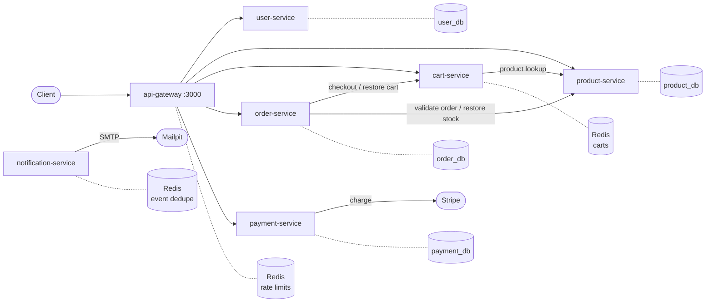
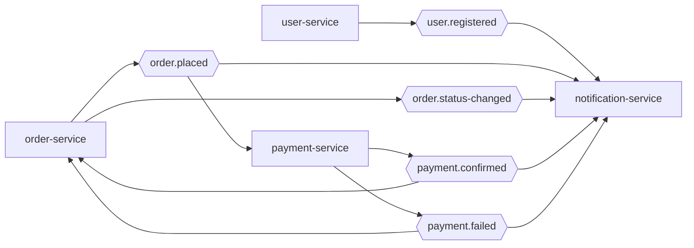
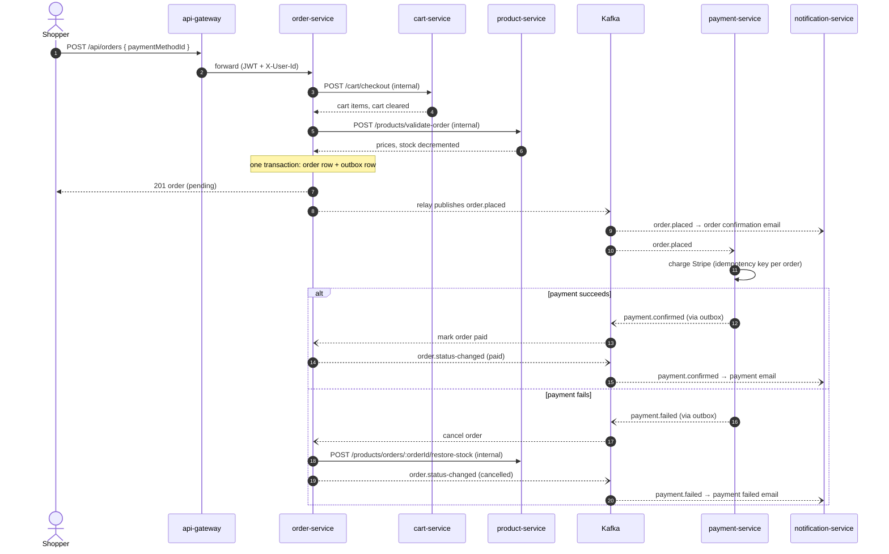

# Scalable E-Commerce Platform

[](https://github.com/lcs-franco/scalable-ecommerce-api/actions/workflows/ci.yml)

An e-commerce backend split into seven TypeScript microservices behind an API gateway, wired with HTTP for queries and Kafka for everything that happens after an order is placed. The MVP is complete: a shopper can register, browse, fill a cart, place an order, pay through Stripe (test mode) and receive the emails, all in containers with one command.

What it demonstrates:

- **Distributed consistency without distributed transactions**: order placement is a saga with compensations, and every event leaves through a transactional outbox, so a crash never loses or invents an event.
- **At-least-once delivery handled end to end**: stable event ids, idempotent consumers and order-keyed stock restore make redelivery harmless.
- **Tests against the real thing**: integration tests run against real Postgres, Redis and a Kafka broker, locally and in CI.

## Contents

- [Architecture](#architecture)
- [Order lifecycle](#order-lifecycle)
- [Patterns and design decisions](#patterns-and-design-decisions)
- [Services](#services)
- [Tech stack](#tech-stack)
- [Project structure](#project-structure)
- [Quickstart](#quickstart)
- [Testing](#testing)
- [Known limitations and next steps](#known-limitations-and-next-steps)
- [License](#license)

## Architecture

Clients only talk to the gateway. Each service owns its store; services call each other over HTTP only where the caller needs an answer to continue.



The four databases are logical databases in one Postgres container; the Redis stores share one Redis container.

Events flow through five Kafka topics:



## Order lifecycle



`order.status-changed` only sends an email for `shipped` and `delivered`; `paid` and `cancelled` are covered by the payment emails.

If anything fails before the order row commits (empty cart, insufficient stock, an upstream down), the saga undoes the earlier steps (best effort, see [Known limitations](#known-limitations-and-next-steps)) and the shopper gets the error.

## Patterns and design decisions

### Saga with compensations

`placeOrder` checks out the cart, then reserves stock, then writes the order. Each step registers its undo (`restore cart`, `restore stock`), and on failure they run in reverse order. A shared database or a two-phase commit across services would couple them; a saga keeps each service the owner of its data and makes the rollback explicit. Code: [`services/order-service/src/config/saga.ts`](services/order-service/src/config/saga.ts), [`services/order-service/src/services/order.service.ts`](services/order-service/src/services/order.service.ts). Spec: [`specs/04-order-service.md`](specs/04-order-service.md).

### Transactional outbox, at-least-once delivery, idempotent consumers

Services never publish to Kafka from a request. They `enqueue` the event into their own `outbox` table in the same transaction as the state change, and a relay in the service process publishes pending rows in order, marking them published. A commit without its event, or an event for a rolled-back change, is impossible ([#37](https://github.com/lcs-franco/scalable-ecommerce-api/issues/37)). Published rows are purged after 7 days ([#62](https://github.com/lcs-franco/scalable-ecommerce-api/issues/62)). Code: [`packages/events/src/outbox.ts`](packages/events/src/outbox.ts).

The relay can publish a row twice (crash between publish and mark), so every consumer tolerates duplicates:

- each message carries the outbox row id as the `event-id` header, stable across redeliveries ([#64](https://github.com/lcs-franco/scalable-ecommerce-api/issues/64));
- notification-service claims the `event-id` in Redis (`SET NX` with a TTL) before sending, so an email goes out once ([#61](https://github.com/lcs-franco/scalable-ecommerce-api/issues/61), [`services/notification-service/src/dedupe.ts`](services/notification-service/src/dedupe.ts));
- payment-service has one payment per order (unique `order_id`) and charges Stripe with an idempotency key derived from the order ([`services/payment-service/src/services/payment.service.ts`](services/payment-service/src/services/payment.service.ts));
- payment events only move an order out of `pending`, and stock restore after a failed payment is keyed by order id in product-service, so a second `payment.failed` restores nothing ([#38](https://github.com/lcs-franco/scalable-ecommerce-api/issues/38)).

### Gateway allowlist and access levels

The gateway proxies only the routes listed in [`services/api-gateway/src/routes/table.ts`](services/api-gateway/src/routes/table.ts); anything else is a 404, so a new internal route can never leak by accident. Each route declares `public`, `user` or `admin`, checked before proxying, and requests are rate limited in Redis with a sliding window (anonymous and authenticated limits differ). The gateway forwards `Authorization` plus `X-User-Id`, `X-User-Role` and `X-Request-Id`; services still verify the JWT themselves. Spec: [`specs/07-api-gateway.md`](specs/07-api-gateway.md).

### Internal-token service auth

Service-to-service routes (cart checkout, validate order, restore stock) declare `config: { internal: true }`. The shared [`@ecommerce/auth`](packages/auth/src/index.ts) plugin then requires the `x-internal-token` shared secret instead of a JWT ([#30](https://github.com/lcs-franco/scalable-ecommerce-api/issues/30)), and [`@ecommerce/docs`](packages/docs/src/index.ts) hides the route from the API docs. Cart restore is the exception: it calls the public `POST /cart/items` with the shopper's own token.

### Poison messages

A message that is not JSON or fails its Zod schema is logged with topic, partition and offset and skipped, instead of blocking the partition with endless retries. Code: [`packages/events/src/consumer.ts`](packages/events/src/consumer.ts). Handler failures are not yet routed to a dead-letter topic ([#34](https://github.com/lcs-franco/scalable-ecommerce-api/issues/34)).

### Fail-fast startup and health-based readiness

Every service validates its environment with Zod and exits on a missing or invalid variable. Migrations and Kafka connections run before `listen`, so once `GET /health` answers, the service is ready. Compose uses that as the healthcheck and starts dependents (gateway, seeds) only after it passes. Code: each service's env config and `src/index.ts`, [`docker-compose.yml`](docker-compose.yml). Spec: [`specs/00-mvp-platform.md`](specs/00-mvp-platform.md).

## Services

| Service              | Port | Store                 | Responsibility                                  | API docs (`pnpm dev`)                             |
| -------------------- | ---- | --------------------- | ----------------------------------------------- | ------------------------------------------------- |
| api-gateway          | 3000 | Redis (rate limits)   | Routing allowlist, access levels, rate limiting | none                                              |
| user-service         | 3001 | Postgres `user_db`    | Registration, login, refresh tokens, profile    | [localhost:3001/docs](http://localhost:3001/docs) |
| product-service      | 3002 | Postgres `product_db` | Catalog, categories, stock                      | [localhost:3002/docs](http://localhost:3002/docs) |
| cart-service         | 3003 | Redis                 | Shopping cart                                   | [localhost:3003/docs](http://localhost:3003/docs) |
| order-service        | 3004 | Postgres `order_db`   | Order placement saga and status lifecycle       | [localhost:3004/docs](http://localhost:3004/docs) |
| payment-service      | 3005 | Postgres `payment_db` | Stripe charges driven by `order.placed`         | [localhost:3005/docs](http://localhost:3005/docs) |
| notification-service | 3006 | Redis (event dedupe)  | Emails (SMTP, Mailpit in dev) from events       | none (no HTTP API)                                |

The per-service docs (Swagger + Scalar, generated from the Zod route schemas) are reachable only under `pnpm dev`, which exposes ports 3001–3006; `docker compose up` publishes no service port except the gateway's. Aggregated docs in the gateway are [#45](https://github.com/lcs-franco/scalable-ecommerce-api/issues/45). Each service has a spec in [`specs/`](specs/).

## Tech stack

- **Runtime**: Node.js 22 · TypeScript · ESM
- **Framework**: Fastify, Zod for validation and OpenAPI
- **ORM**: Drizzle (migrations per service)
- **Messaging**: Kafka in KRaft mode (KafkaJS)
- **Storage**: PostgreSQL 16 · Redis 7
- **Payments**: Stripe (test mode)
- **Logging**: Pino, shared by Fastify, KafkaJS and the consumers
- **Testing**: Vitest
- **Monorepo**: pnpm workspaces · Docker Compose

## Project structure

```
services/               → one folder per service (see Services above)

packages/
  auth/                 → Fastify JWT plugin, internal-token routes
  docs/                 → OpenAPI (Swagger + Scalar) from Zod route schemas
  events/               → topics, Zod event schemas, producer/consumer, outbox, test helpers
  logger/               → Pino logger factory

specs/                  → MVP and per-service specs
infra/postgres/         → script that creates the service databases
```

## Quickstart

### Prerequisites

- Docker with Compose v2
- A [Stripe test mode](https://dashboard.stripe.com/test/apikeys) secret key (`sk_test_...`): payments are processed against Stripe
- Node.js 22 and pnpm 11 (for `pnpm dev`, tests and lint)

### Run the whole platform

```bash
cp .env.example .env   # then set STRIPE_SECRET_KEY
docker compose up --build
```

This starts Postgres, Redis, Kafka, Mailpit and the seven services, creates the Kafka topics, and seeds an admin user (`admin@example.com` / `ADMIN_PASSWORD`) and sample products. The platform is ready when `api-gateway` is healthy.

| URL                          | What                                   |
| ---------------------------- | -------------------------------------- |
| http://localhost:3000/api    | API Gateway (the only public API port) |
| http://localhost:3000/health | Gateway liveness                       |
| http://localhost:8025        | Mailpit: emails sent by the platform   |

Shopper journey through the gateway: `POST /api/auth/register` → `POST /api/auth/login` → `GET /api/products` → `POST /api/cart/items` → `POST /api/orders` (body `{ "paymentMethodId": "pm_card_visa" }`; `pm_card_chargeDeclined` exercises the failure path) → the order becomes `paid` once Stripe confirms → `GET /api/payments/order/:orderId`, with welcome, order and payment emails in Mailpit.

### Develop

`pnpm dev` (stop with `pnpm dev:down`) runs the platform with hot reload: each service runs `tsx watch` with its `src/` mounted, and ports 3001–3006 are exposed for debugging. Changes to `packages/*` or dependencies need a rebuild (`pnpm dev` builds on start).

## Testing

```bash
docker compose up -d postgres redis kafka kafka-init mailpit
pnpm install && pnpm build
pnpm test
```

- **Integration first**: each service builds its Fastify app with `buildApp(deps)` against real Postgres and Redis, and asserts events as rows in its `outbox` table.
- **Real broker**: the `kafka.test.ts` suites (and notification's `consumers.test.ts`) run the outbox relay and the consumers against Kafka, using the helpers in `@ecommerce/events/testing`. Run them against the infra-only command above, not `pnpm dev`: the running services' consumer groups would also consume the test messages.
- **What is faked**: only the payment provider. payment-service tests inject a fake processor, the Stripe adapter is unit-tested against a stubbed SDK, and a contract test hits the real Stripe test API when `STRIPE_SECRET_KEY` is exported in the shell (skipped in CI).
- **CI** ([`.github/workflows/ci.yml`](.github/workflows/ci.yml)): on every PR to `main`, typecheck and build, then the full suite with Postgres and Redis as service containers and Kafka started from `docker-compose.yml`.

## Known limitations and next steps

- No dead-letter topic or retry policy for handler failures ([#34](https://github.com/lcs-franco/scalable-ecommerce-api/issues/34)).
- Payments that need 3D Secure (`requires_action`) are not handled ([#57](https://github.com/lcs-franco/scalable-ecommerce-api/issues/57)).
- No automated end-to-end test of the shopper journey through the gateway ([#35](https://github.com/lcs-franco/scalable-ecommerce-api/issues/35)).
- `X-Request-Id` reaches the services but is not yet in their logs ([#46](https://github.com/lcs-franco/scalable-ecommerce-api/issues/46)).
- The restore-stock compensation in the placement saga is not idempotent ([#21](https://github.com/lcs-franco/scalable-ecommerce-api/issues/21)).

Everything else planned is in the [open issues](https://github.com/lcs-franco/scalable-ecommerce-api/issues).

## License

[MIT](LICENSE)
